

<h1 align="center">PioTile</h1>

<b>Vezi plăcile în camera ta, înainte să le cumperi.</b> 
Placări în 3D · desktop Windows · offline

<a href="https://piotile.com">piotile.com</a> ·
<a href="https://piogrup.gumroad.com/l/piotile-demo">Descarcă Demo</a> ·
<a href="https://piotile.com/demo/">Încearcă online</a> ·
<a href="https://piogrup.gumroad.com/l/piotile">Cumpără</a>

<b>RO</b> · <a href="#english">EN</a>

> Acest depozit este doar de prezentare. **Codul sursă nu este public.** Aplicația se descarcă de pe [piotile.com](https://piotile.com) sau [Gumroad](https://piogrup.gumroad.com/l/piotile-demo).

PioTile pune plăcile reale pe camera ta măsurată (pereți, podea, uși, mobilier de baie) și îți spune exact câte să comanzi. Nu o poză frumoasă cu plăci inventate: PioTile așază plăci cu dimensiunile reale, cu rost, tăieturi și goluri.

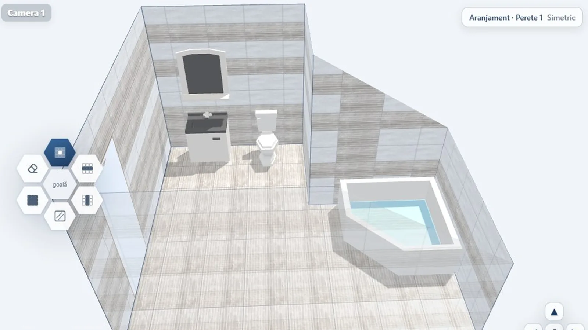

## Ce face

- **Camera ta în 3D.** Camere de orice formă, de la dreptunghi până la 24 de colțuri, cu pereți înclinați de mansardă. Rotești camera, intri în ea, faci un perete transparent sau îl ascunzi.
- **Culori și texturi dintr-un clic.** Pictezi o placă, un rând, o coloană sau tot peretele. Marmură, beton, lemn, mozaic, sau încarci poza plăcii tale.
- **Aranjamente și rost.** Colț la colț, simetric, cărămidă, romb, cu rostul ales de tine. Tu decizi de unde încep plăcile.
- **Uși, ferestre, mobilier de baie.** Golurile se decupează din placare. Cadă, duș, lavoar, WC, oglindă, nișă, podest, la dimensiuni reale. Cu clic dreapta rotești obiectul cu orice unghi.
- **Desfășurarea 2D a pereților.** Fiecare perete întins, cu plăcile întregi și tăiate și cotele lor, gata pentru faianțar.
- **Cantități exacte.** m², plăci întregi și tăiate, pierderi, suprafață de comandat, pe cameră sau pe tot proiectul, în PDF sau Excel.
- **Import din SketchUp și AutoCAD.** Deschizi un fișier OBJ, GLB sau DXF: PioTile găsește camerele din plan, închide golurile de ușă și ți le propune una câte una.
- **Planul proiectului.** Un plan mic al întregului proiect: un clic pe o cameră o deschide.
- **Pentru showroom.** Trimiți camera 3D pe un televizor sau o tabletă prin Wi-Fi, ori pe al doilea ecran. Tu schimbi plăcile pe calculator, clientul le vede schimbându-se pe loc.
- **Randare de prezentare** (Full HD, 2K, 4K) și **clip 3D** al camerei.
- **24 de limbi.** Aplicația, manualul și site-ul vorbesc limba ta.

**Aranjamente:** colț la colț · simetric · cărămidă cu decalaj ½ · romb 45° · romb cărămidă · brâuri și rânduri decor · metric sau inch.

## Cum arată

Aplicația reală, nu o machetă. Fiecare imagine e o captură din PioTile.

| | |
|---|---|
| 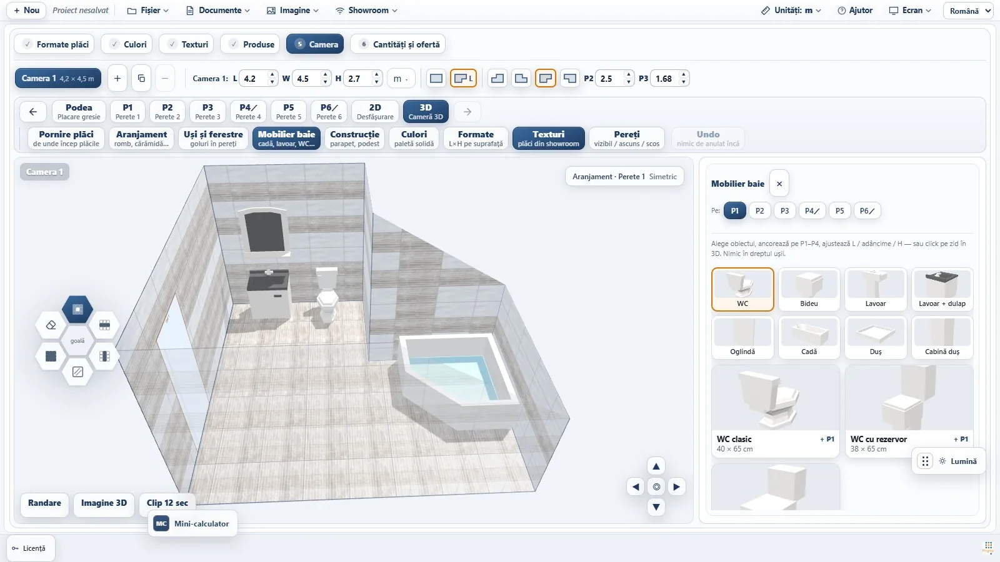 Mobilier de baie la dimensiuni reale | 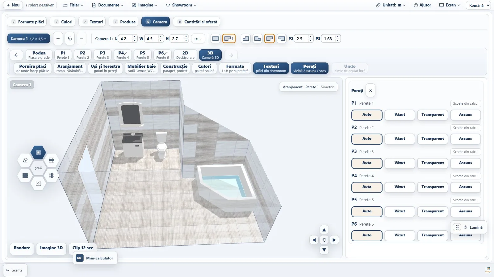 Pereți văzuți, transparenți sau ascunși |
| 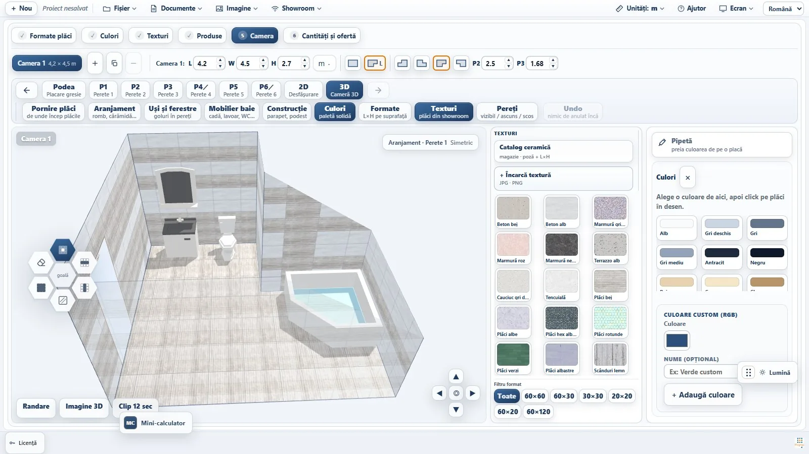 Culori și texturi, pictate direct pe plăci | 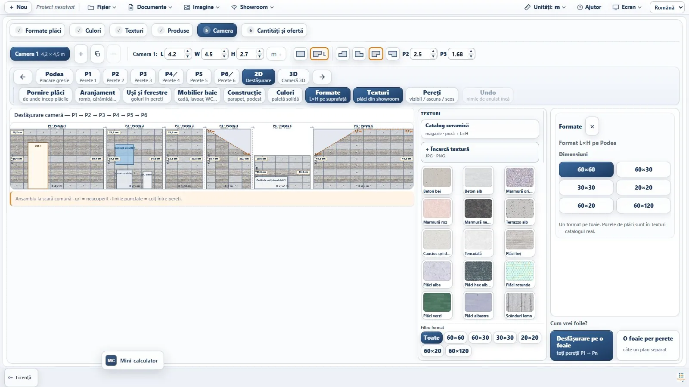 Desfășurarea 2D, cu plăcile tăiate |
| 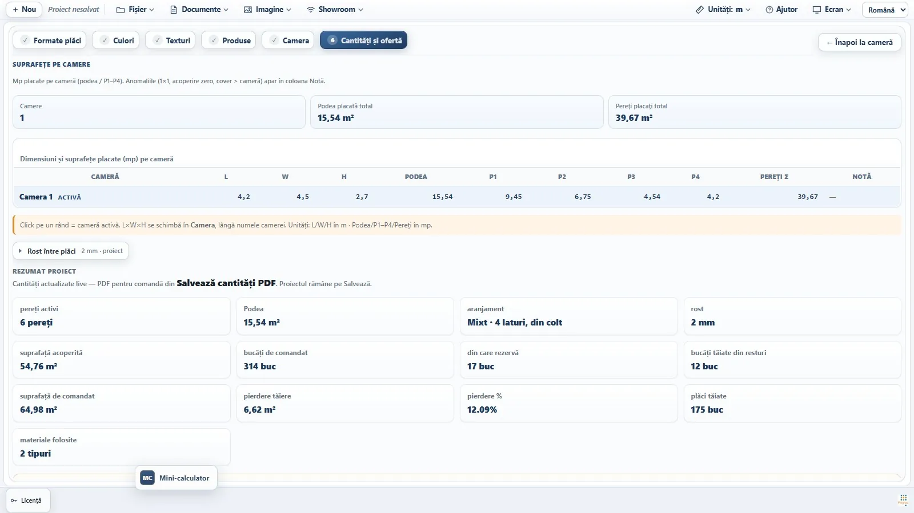 Cantități: m², bucăți, pierderi | 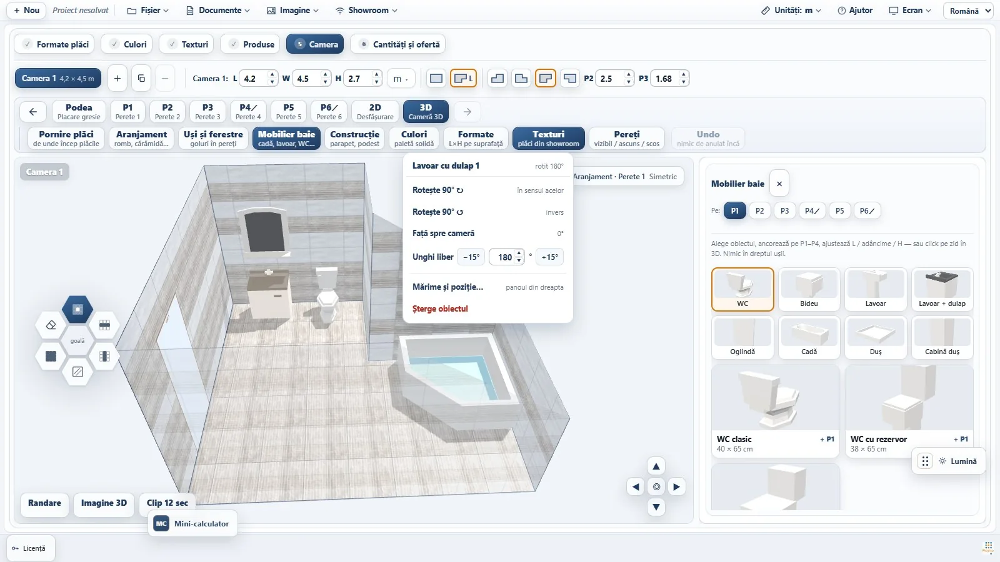 Clic dreapta pe obiect: rotire cu orice unghi |
| 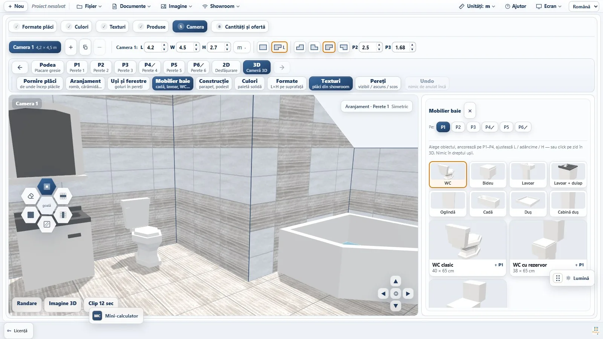 Baia văzută din interior, la nivelul ochilor | 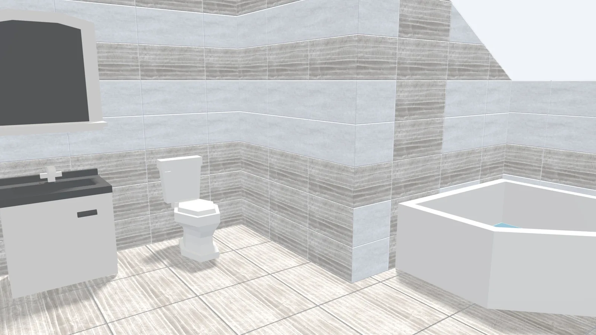 Randare de prezentare, gata de trimis clientului |
|  Importul din SketchUp: camerele găsite în plan | 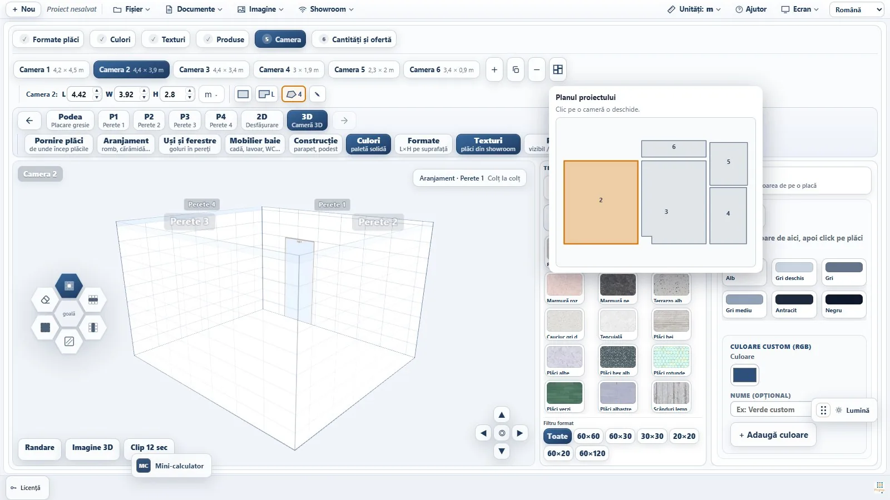 Planul proiectului: deschizi orice cameră cu un clic |
| 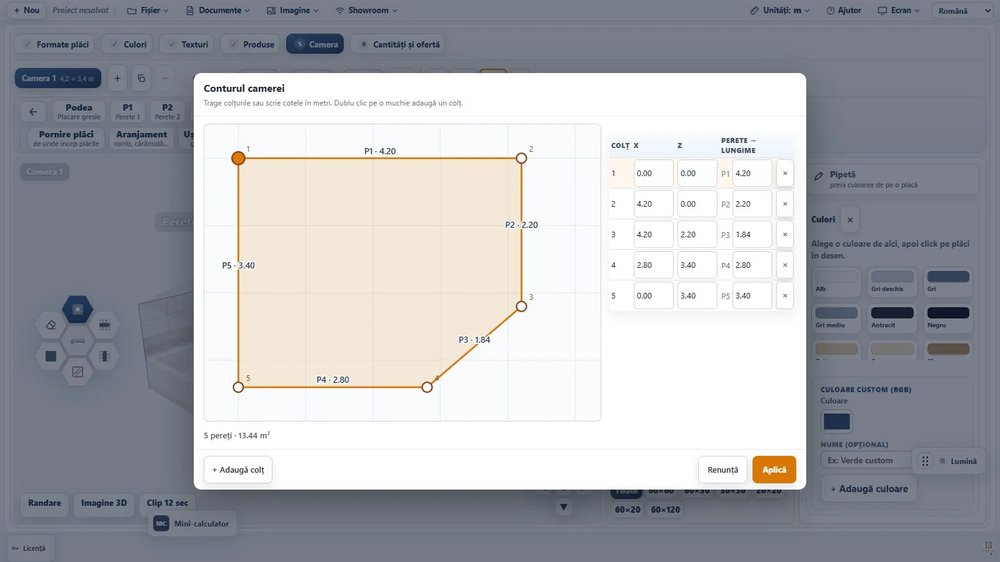 Camere de orice formă, cu editor de contur | |

Un clip de un minut cu aplicația reală este pe [piotile.com](https://piotile.com).

## Încearcă

- **Demo gratuit, 10 zile**, cu toate funcțiile: [descarcă de pe Gumroad](https://piogrup.gumroad.com/l/piotile-demo). Fără cont, fără card, funcționează offline. După 10 zile aplicația rămâne deschisă în mod limitat: camera și materialele implicite, fără salvare și fără documente.
- **Proba online**, fără instalare: [piotile.com/demo](https://piotile.com/demo/). Pe o cameră gata făcută pictezi pereții și podeaua, adaugi o ușă și o cadă și citești cantitățile. Totul rulează în browserul tău, nimic nu se trimite și nimic nu se salvează.

## Preț

**€250, plată unică** (+ TVA, calculat la plată în funcție de țară). Fără abonament lunar și fără abonament pentru folosirea mostrelor de material. Licența e legată de calculator, o cheie per calculator. Actualizări gratuite.

[Cumpără PioTile](https://piogrup.gumroad.com/l/piotile)

**Activare:** descarci aplicația o singură dată, trimiți Seria de Instalare (la Licență, jos-stânga) la office@piogrup.com, primești cheia și o lipești în PioTile. Nu reinstalezi nimic.

## Manual

Manualul de utilizare, pas cu pas, cu imagini din aplicație: [PDF în română](https://piotile.com/manual/PioTile-Manual-RO.pdf) · [PDF in English](https://piotile.com/manual/PioTile-Manual-EN.pdf). Este disponibil în 24 de limbi pe [piotile.com](https://piotile.com).

## Pentru magazine de gresie și faianță

Încărcăm colecțiile tale în PioTile (poze reale, formate și prețuri), cu logo-ul tău pe imagini, clipuri și PDF, plus instalare în showroom și instruire. Personalizarea se ofertează pe proiect: [scrie-ne](mailto:office@piogrup.com?subject=PioTile%20%E2%80%94%20catalog).

## Licență

Produs comercial. © 2026 Piogrup. Toate drepturile rezervate. Vezi [LICENSE](LICENSE). Folosirea aplicației este reglementată de [EULA](https://piotile.com/eula).

---

## English

> This repository is a showcase only. **The source code is not public.** Download the app from [piotile.com](https://piotile.com) or [Gumroad](https://piogrup.gumroad.com/l/piotile-demo).

**See the tiles in your room before you buy them.** PioTile puts real tiles in your measured room (walls, floor, doors, bathroom fixtures) and tells you exactly how many to order. Not a pretty picture with made-up tiles: PioTile lays real tile sizes, with grout, cuts and openings. Windows desktop app, works offline.

### Features

- **Your room in 3D.** Rooms of any shape, from a rectangle to 24 corners, with sloped attic walls. Turn the room, step inside, make a wall transparent or hide it.
- **Colours and textures in one click.** Paint a tile, a row, a column or the whole wall. Marble, concrete, wood, mosaic, or upload a photo of your own tile.
- **Layouts and grout.** Corner to corner, symmetric, brick, diagonal, with the grout width you choose. The start point is up to you.
- **Doors, windows, bathroom fixtures.** Openings are cut out of the tiling. Bathtub, shower, basin, WC, mirror, niche, platform, in real sizes. Right-click an object to rotate it by any angle.
- **2D layout of the walls.** Every wall laid flat, with whole and cut tiles and their sizes, ready for the tiler.
- **Exact quantities.** m², whole and cut tiles, waste, area to order, per room or for the whole project, as PDF or Excel.
- **Import from SketchUp and AutoCAD.** Open an OBJ, GLB or DXF file: PioTile finds the rooms in the plan, closes the door gaps and offers them one by one.
- **The project plan.** A small plan of the whole project: click a room to open it.
- **For showrooms.** Send the 3D room to a TV or a tablet over Wi-Fi, or to a second screen. You change the tiles on the computer, the client watches them change live.
- **Presentation render** (Full HD, 2K, 4K) and a **3D clip** of the room.
- **24 languages.** The app, the manual and the website speak your language.

**Layouts:** corner to corner · symmetric · brick ½ offset · diagonal 45° · diagonal brick · borders and accent rows · metric or inch.

### Screenshots

The real app, not a mock-up.

| | |
|---|---|
| 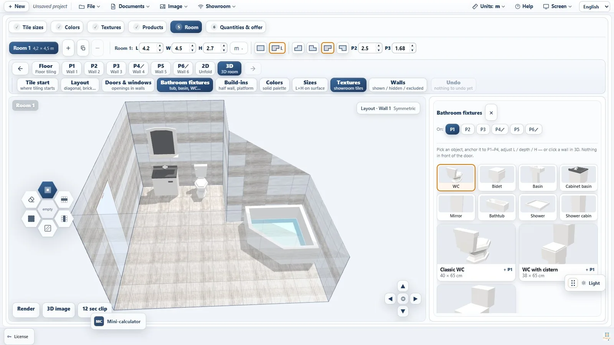 Bathroom fixtures in real sizes | 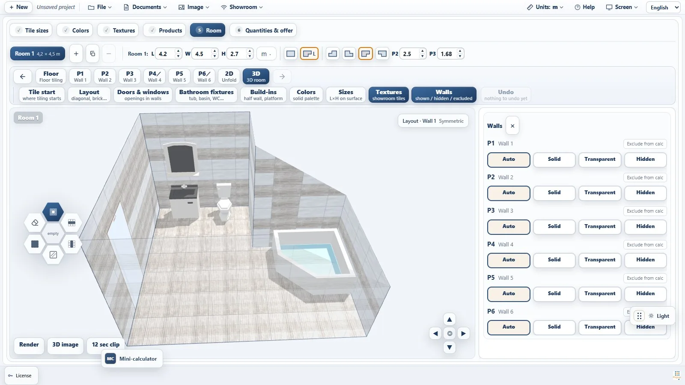 Walls shown, transparent or hidden |
| 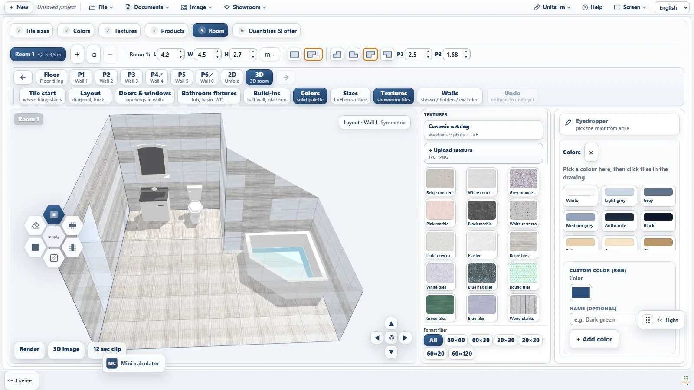 Colours and textures, painted on the tiles | 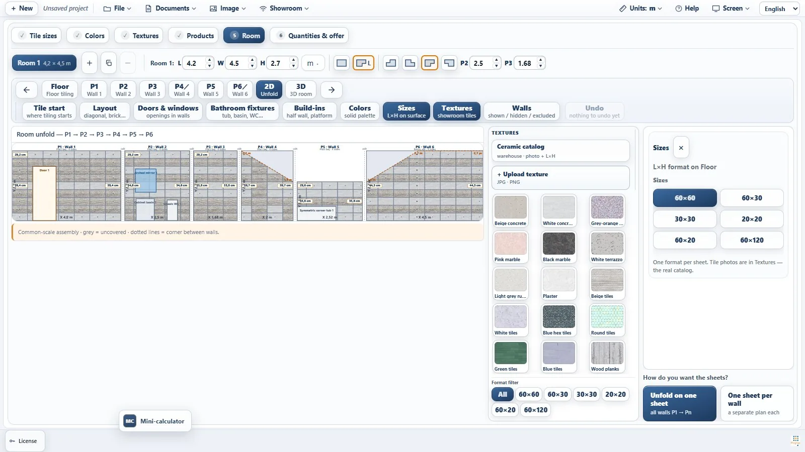 2D wall layout, with cut tiles |
| 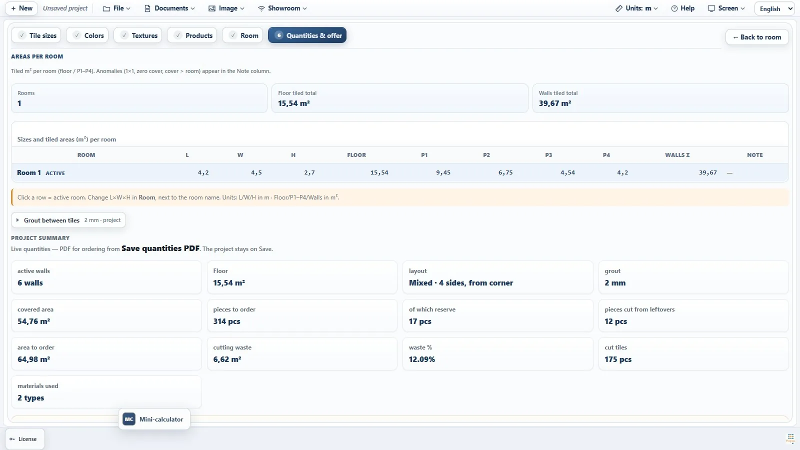 Quantities: m², pieces, waste | 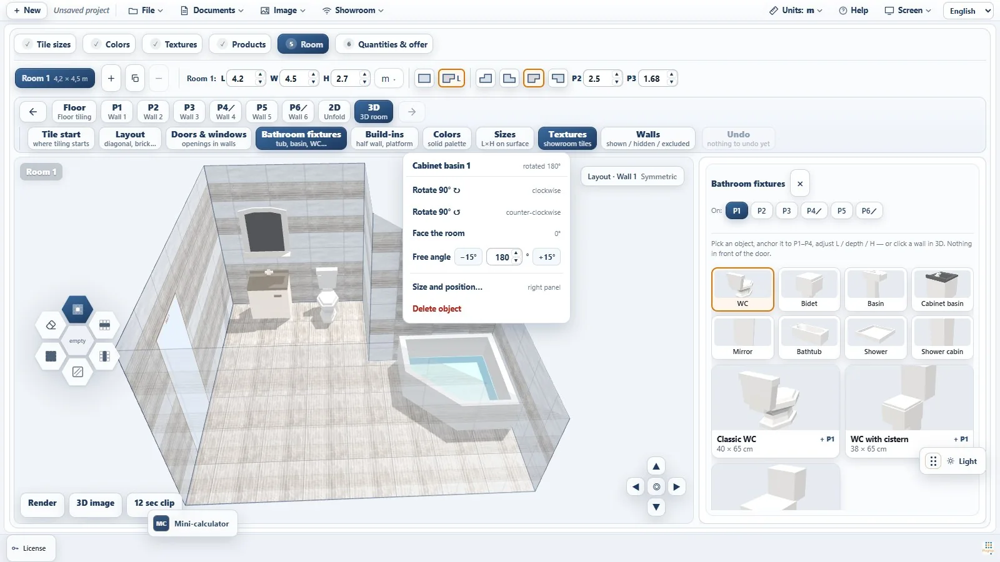 Right-click an object: rotate by any angle |
| 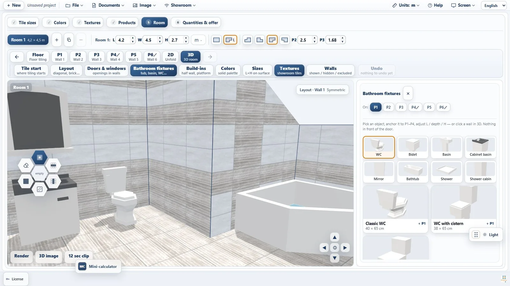 The bathroom from inside, at eye level |  Presentation render, ready to send to your client |
| 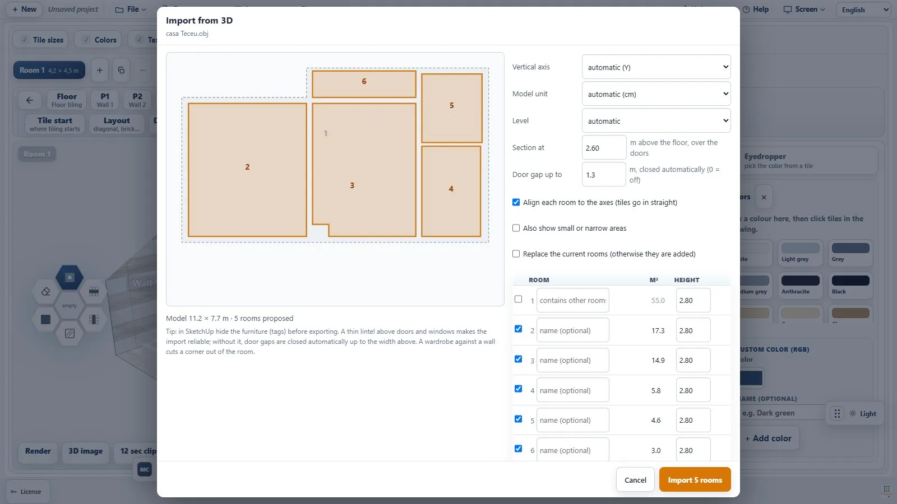 Import from SketchUp: the rooms found in the plan | 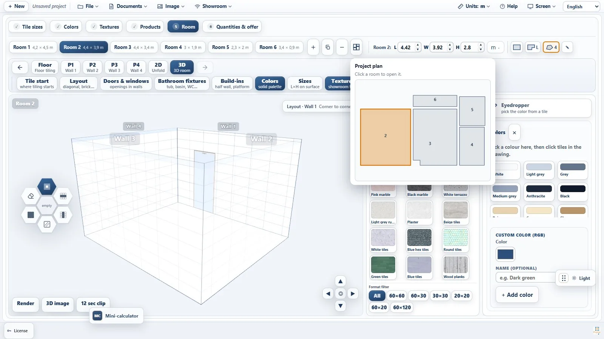 The project plan: open any room with one click |
| 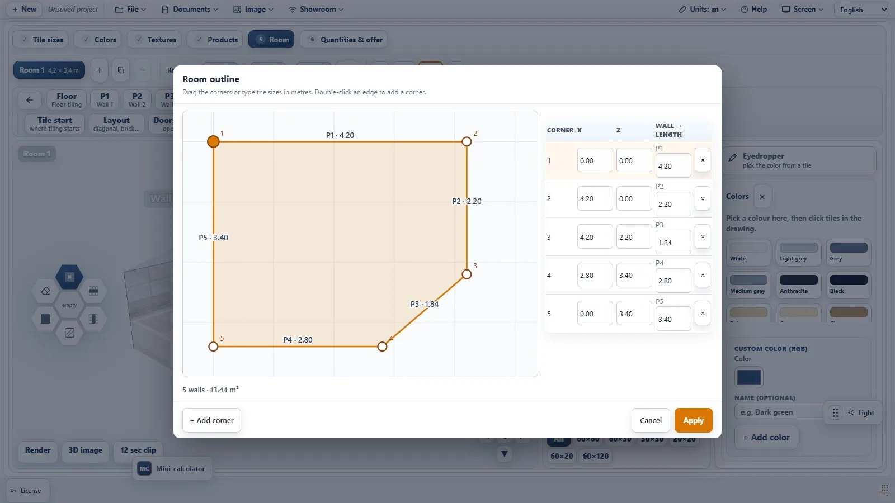 Rooms of any shape, with an outline editor | |

A one-minute video of the real app is on [piotile.com](https://piotile.com).

### Try it

- **Free 10-day Demo**, all features: [download from Gumroad](https://piogrup.gumroad.com/l/piotile-demo). No account, no card, works offline. After 10 days the app stays open in limited mode: the default room and materials, no saving and no documents.
- **Online trial**, no install: [piotile.com/demo](https://piotile.com/demo/). On a ready-made room you paint the walls and floor, add a door and a bathtub and read the quantities. Everything runs in your browser; nothing is uploaded and nothing is saved.

### Pricing

**€250, one-time payment** (+ VAT, calculated at checkout by country). No monthly subscription, and no subscription to use material samples. The licence is tied to your computer, one key per machine. Free updates.

[Buy PioTile](https://piogrup.gumroad.com/l/piotile)

**Activation:** download the app once, email your Installation Serial (under Licence, bottom-left) to office@piogrup.com, get your key and paste it in PioTile. No reinstall.

### Manual

Step-by-step user manual with pictures from the app: [PDF in English](https://piotile.com/manual/PioTile-Manual-EN.pdf). Available in 24 languages on [piotile.com](https://piotile.com).

### For tile shops

We load your collections into PioTile (real photos, sizes and prices), with your logo on images, clips and PDFs, plus showroom setup and training. Customisation is quoted per project: [write to us](mailto:office@piogrup.com?subject=PioTile%20%E2%80%94%20catalog).

### Licence

Commercial product. © 2026 Piogrup. All rights reserved. See [LICENSE](LICENSE). Use of the app is governed by the [EULA](https://piotile.com/eula).
